# Inside a Foundry IQ knowledge graph: a portal walkthrough

This walkthrough covers everything Foundry IQ (Azure AI Search) creates when you add an entity graph to a blob knowledge source. Each section shows a portal screenshot, explains what you see, adds what the portal leaves out, and links to Microsoft Learn.

It belongs to a demo that compares plain RAG, Microsoft Retriever 1 and knowledge graphs on a synthetic corpus: 246 project documents from a fictional consultancy, Kestrel Consulting. Screenshots were taken on 2026-11-18 while entity extraction was still running, so the counts are mid-ingestion numbers.

- Search service: `srch-kestrel-r1`, Serverless, West US 3
- Search REST API: `2026-11-01-preview`
- Models (Sweden Central): `gpt-5.6-luna` for extraction and query planning, `text-embedding-3-small` for embeddings
- Full JSON definitions of every object: [`definitions/`](definitions/)

> **The short version.** One `PUT /knowledgesources` call with a `graphExtraction` block creates **six** objects: a data source, a skillset, an indexer, a chunk index, a graph index, and the knowledge source that owns them. A knowledge base on top turns natural-language questions into text search and GQL graph queries. The portal shows all of it, but it can't display the graph-specific configuration yet. For that you need the JSON.

## How the pieces fit together

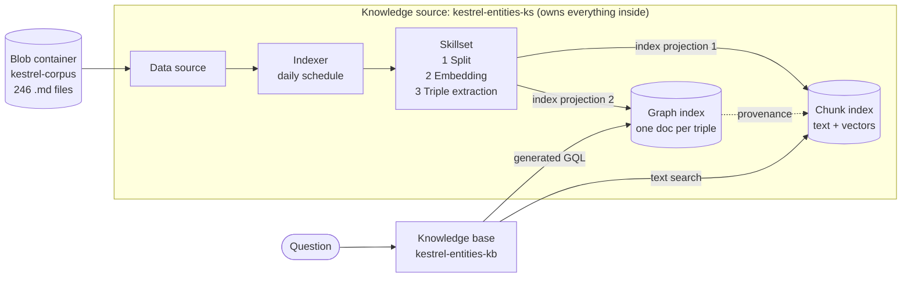

The pipeline is a classic Azure AI Search indexer pipeline. What's new is the third skill and the second index projection, which together produce a graph next to the familiar chunk index.

---

## 1. The service

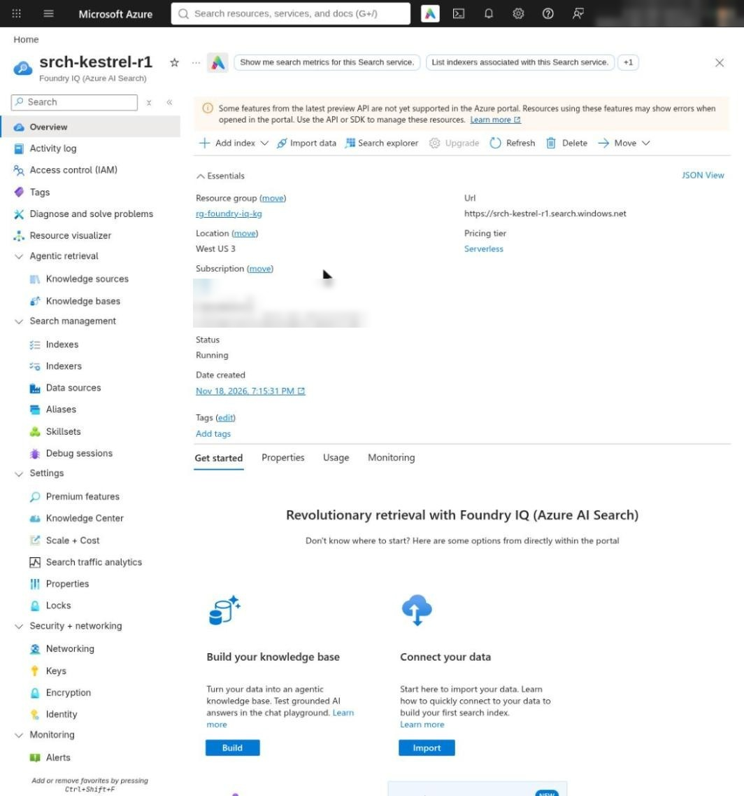

- **Pricing tier: Serverless.** Serverless is consumption-based: you pay for compute units and indexed storage, and the service scales for you ([pricing models](https://learn.microsoft.com/azure/search/search-sku-tier)). An idle service costs only its storage. It supports the same APIs as the Dedicated tiers.
- **Location: West US 3.** This wasn't our first choice. We started in Sweden Central, but Microsoft Retriever 1 (`queryType: "agentic"`) returned *"Agentic retrieval is not available in this region or environment."* The region table on Learn has no Retriever 1 column. The [Fetch Offerings](https://learn.microsoft.com/azure/search/search-region-support#discover-regional-offerings-with-the-management-rest-api-preview) management API does, and it listed `MicrosoftRetriever` only in West US 3, West Central US, North Europe and Japan East. North Europe offers no Serverless, so we moved everything to West US 3.
- **No Serverless SKU in the Azure CLI yet.** `az search service create` doesn't offer it. We created the service through the management REST API (`2026-09-01-Preview`) with `"sku": {"name": "serverless"}`.
- **The orange banner** warns that features from the latest preview API aren't supported in the portal yet, and that resources using them may show errors. You'll see the effect of that in several sections below.
- **Not visible here: the billing plan for agentic retrieval.** Under *Premium features* there's a separate `knowledgeRetrieval` plan, `free` or `standard`. Microsoft Retriever 1 has no free tier: the first call returned HTTP 402 until we switched the plan to `standard` ([enable agentic retrieval billing](https://learn.microsoft.com/azure/search/agentic-retrieval-how-to-enable-disable)). The plan is independent of the pricing tier, so the service stays Serverless.

## 2. Knowledge sources and knowledge bases: the agentic layer

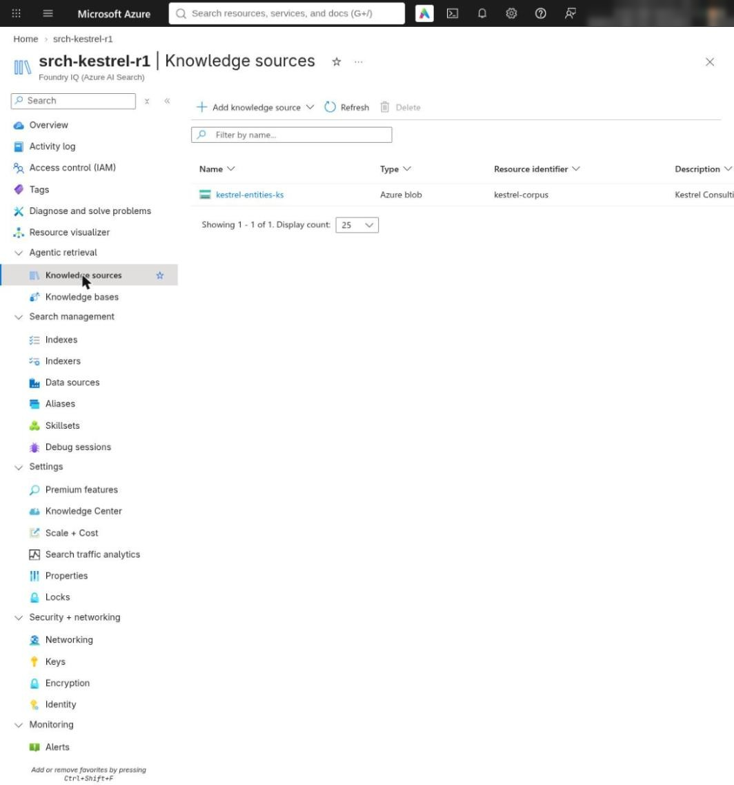
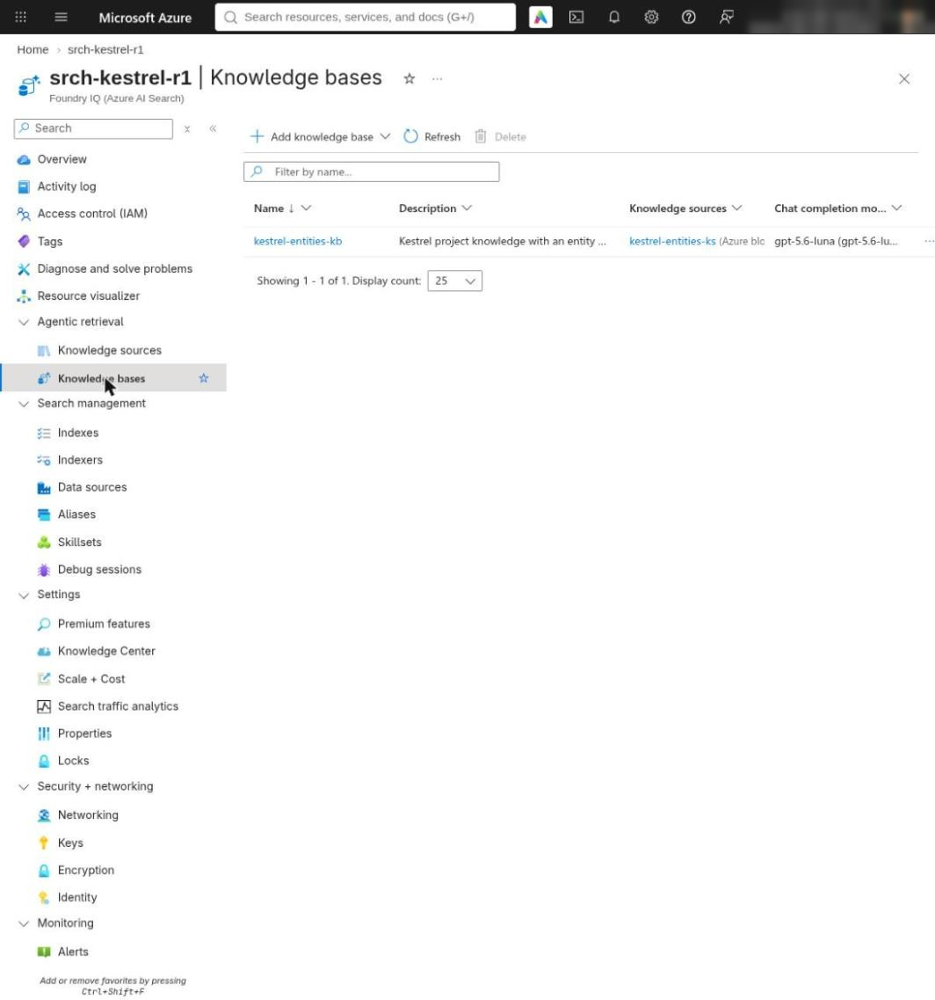

These two blades sit under **Agentic retrieval** in the menu, above the classic *Search management* objects. That placement matches the architecture:

- A **knowledge source** describes *where* content comes from and *how* it's ingested. A blob knowledge source automatically generates a data source, a skillset, an index and an indexer ([blob knowledge source](https://learn.microsoft.com/azure/search/agentic-knowledge-source-how-to-blob)).
- A **knowledge base** describes *how* to retrieve from one or more knowledge sources at query time: which model plans queries, how much reasoning effort to spend, and what to return. Every knowledge base is also an MCP endpoint ([query a knowledge base](https://learn.microsoft.com/azure/search/agentic-retrieval-how-to-retrieve)).

The knowledge base list shows the chat completion model, `gpt-5.6-luna`. That's the planning model, separate from the extraction model configured on the knowledge source. Microsoft's entity graph docs recommend `gpt-5.6-luna` with low reasoning effort for both ([entity graph best practices](https://learn.microsoft.com/azure/search/agentic-knowledge-source-how-to-entity-graph#best-practices)).

### The knowledge source in detail

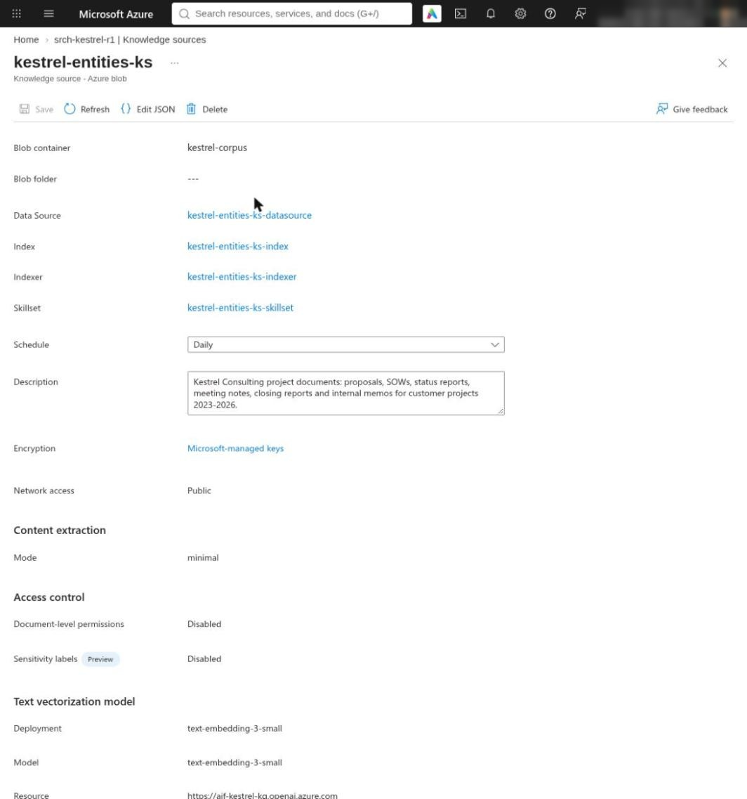
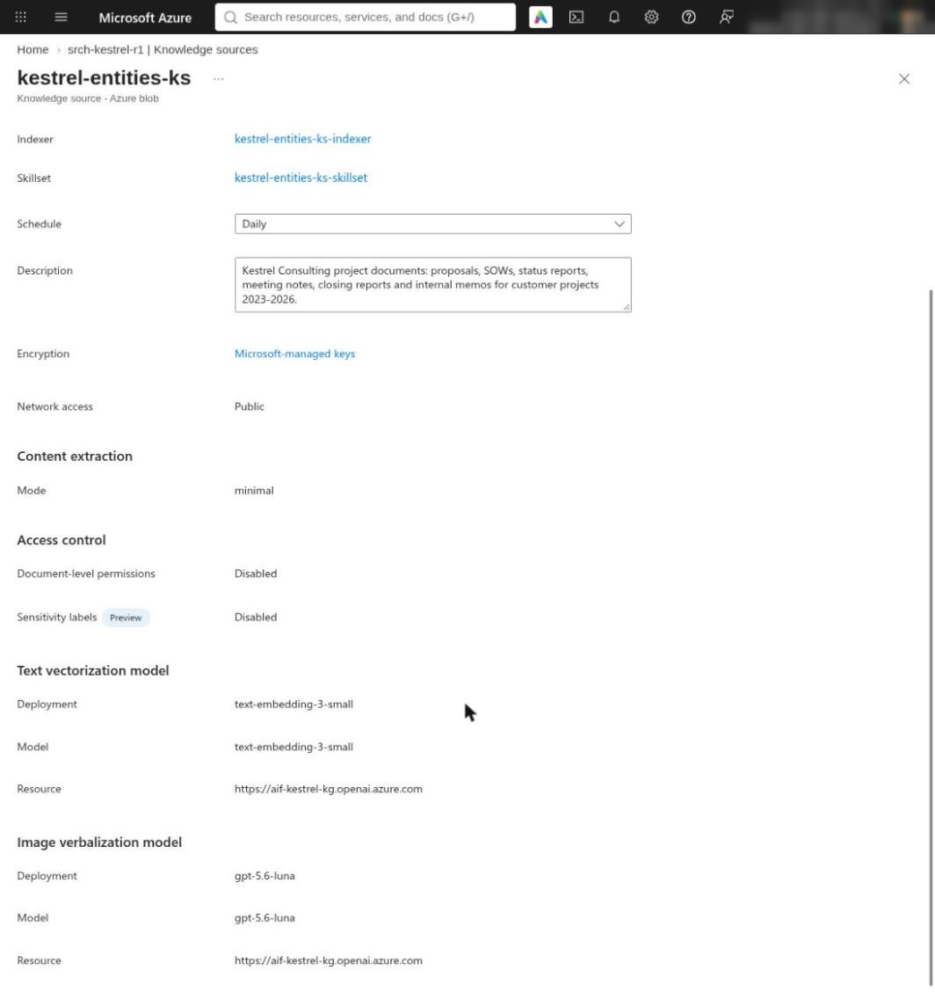

What the page shows:

- **The generated objects:** data source, index, indexer and skillset, each one a link. They're listed under `azureBlobParameters.createdResources` in the API and are read-only. Deleting the knowledge source deletes all of them, but not your blobs ([blob knowledge source: delete](https://learn.microsoft.com/azure/search/agentic-knowledge-source-how-to-blob#delete-a-knowledge-source)).
- **Schedule: Daily.** This is `ingestionSchedule`, how often the generated indexer polls the container. The first run starts at creation.
- **Content extraction mode: minimal.** That's plain text extraction. The alternative, `standard`, uses Content Understanding for layout extraction and semantic chunking, at extra cost ([standard extraction](https://learn.microsoft.com/azure/search/agentic-knowledge-source-how-to-blob#configure-standard-extraction)). For Markdown files, minimal is enough.
- **Document-level permissions: Disabled.** This isn't just our choice: the entity graph workflow doesn't support ACL ingestion or sensitivity-label ingestion ([entity graph prerequisites](https://learn.microsoft.com/azure/search/agentic-knowledge-source-how-to-entity-graph#prerequisites)). Graphs and document-level security don't combine yet.

What the page gets wrong or leaves out:

- **No graph section at all.** The graph index isn't listed, and neither the ontology nor `graphName` nor `pageDegreeOfParallelism` appears. In the API they're under `azureBlobParameters.graphExtraction` and `createdResources.graphIndex` ([knowledge source JSON](definitions/knowledgesource_kestrel-entities-ks.json)).
- **A misleading label.** `gpt-5.6-luna` appears as the **"Image verbalization model"**, but image verbalization is disabled (`disableImageVerbalization: true`). The model is there because graph extraction needs a chat model. The portal has only one label for that field.

Two things to decide **before** creating the source, because you can't change them afterwards:

1. **The ontology.** It's fixed unless the source was created with a reprocessing-enabled ingestion cache, and that cache can't be added later ([create the graph-enabled knowledge source](https://learn.microsoft.com/azure/search/agentic-knowledge-source-how-to-entity-graph#create-the-graph-enabled-knowledge-source)). Our first ontology produced graph queries that returned 0 rows. Fixing it meant deleting the source, recreating it, and re-extracting everything.
2. **A new knowledge base for graph retrieval.** You can't enable entity graph retrieval on an existing knowledge base ([limitations](https://learn.microsoft.com/azure/search/agentic-knowledge-source-how-to-entity-graph#limitations)).

## 3. The data source

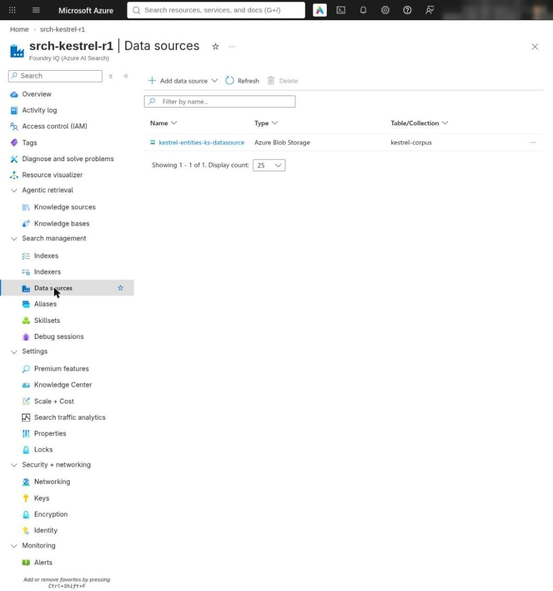

The data source points at the `kestrel-corpus` container, using the search service's managed identity (`ResourceId=...` in the connection string, no keys). For an entity graph, the storage account has two hard requirements:

- **Native blob soft delete enabled before the first indexing run.** It lets the indexer remove documents from the index when their blobs are deleted.
- **Blob versioning disabled.** With versioning on, native soft delete isn't supported by design ([change and delete detection](https://learn.microsoft.com/azure/search/search-how-to-index-azure-blob-changed-deleted#requirements-for-native-soft-delete)).

The deletion policy has to be in place from the very first indexer run. Documents deleted before the policy existed stay in the index, even if you add the policy later and reset the indexer.

**Change detection is automatic for blobs.** The indexer compares each blob's `LastModified` timestamp against its internal high-water mark and processes only new or changed blobs ([change detection](https://learn.microsoft.com/azure/search/search-how-to-create-indexers#change-detection-and-internal-state)). Something that cost us a full re-extraction: uploading with `az storage blob upload-batch --overwrite` resets `LastModified` on every file. Use `az storage blob sync` or upload only new files.

## 4. The skillset: where the graph is made

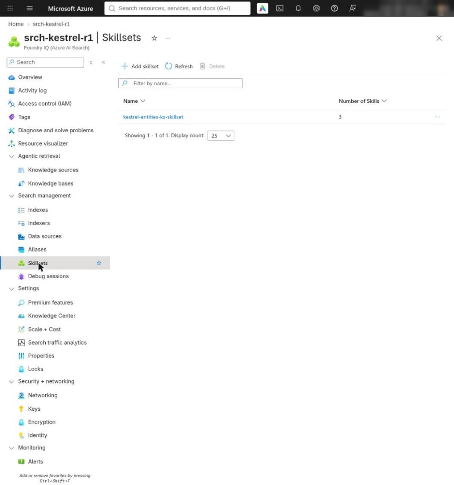
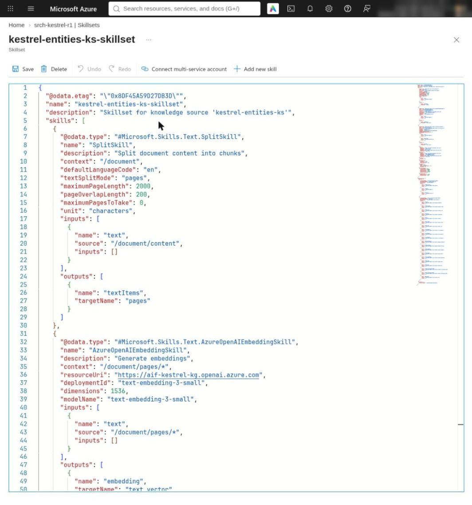

The generated skillset has three skills. The portal only shows them as raw JSON, so the full definition is in [`skillset_kestrel-entities-ks-skillset.json`](definitions/skillset_kestrel-entities-ks-skillset.json).

### Skill 1: Text Split, the chunking

Settings: `textSplitMode: pages`, `maximumPageLength: 2000`, `pageOverlapLength: 200`, `unit: characters`.

- **What it does:** it cuts each document into pages of at most 2,000 characters, about 300 words. It tries to break on sentence boundaries, so pages can be a little shorter ([Text Split skill](https://learn.microsoft.com/azure/search/cognitive-search-skill-textsplit)). Each page starts with the last 200 characters of the previous one, so a fact split across a boundary appears whole in at least one chunk.
- **Compared with Microsoft's advice:** Learn recommends starting with 2,000 characters and a 500-character overlap ([chunking guidance](https://learn.microsoft.com/azure/search/vector-search-how-to-chunk-documents)). The generated pipeline uses less overlap.
- **Effect on our corpus:** 246 documents averaging about 640 words became roughly 2.6 chunks per document.
- **Why chunk size matters for graphs:** every chunk is one extraction call to the LLM, so chunk size directly sets extraction cost and time.

### Skill 2: Azure OpenAI embedding

`text-embedding-3-small`, 1,536 dimensions, one vector per chunk. This is standard [integrated vectorization](https://learn.microsoft.com/azure/search/vector-search-integrated-vectorization).

### Skill 3: TripleExtractionSkill (`#Microsoft.Skills.Graph.TripleExtractionSkill`)

This is the graph builder. The portal shows it only as JSON, and Learn doesn't document the skill on its own yet; it's generated from `graphExtraction`. Its definition reveals more of the internals than any page does:

| Setting | Value | What it suggests |
|---|---|---|
| `context` | `/document/pages/*` | Runs once per chunk, not per document |
| `chat.deployment` | `gpt-5.6-luna` | The extraction model |
| `extraction` | `temperature 0.3`, `reasoningEffort low`, `maxTokens 16384` | A low-temperature, low-effort extraction pass |
| `alignment` | `mode lenient`, `minPredicateConfidence 0.5` | A second pass that maps the extracted relationships onto ontology predicates |
| `grounding` | `null` | No grounding stage configured (see the graph index section) |
| `minEdgeConfidence` | `null` | No confidence threshold |
| `pageDegreeOfParallelism` | `2` | Chunks extracted in parallel. This mainly sets ingestion speed: about 6.7 documents per minute for us |
| `ontology.inlineJsonLd` | our JSON-LD | The ontology is passed straight into the skill |

The "what it suggests" column is our reading of the field names. Microsoft doesn't document these internals.

### Index projections: one skillset, two indexes

The skillset ends with two **index projections**:

| Projection | `sourceContext` | Target index | Key that links a document back to its source |
|---|---|---|---|
| 1 | `/document/pages/*` | `kestrel-entities-ks-index` | `snippet_parent_id` |
| 2 | `/document/pages/*/raw_triples/*` | `kestrel-entities-ks-graph-index` | `chunk_id` |

Index projections are the standard mechanism for one-to-many indexing: one source document becomes many search documents ([index projections](https://learn.microsoft.com/azure/search/search-how-to-define-index-projections)). Both use `projectionMode: skipIndexingParentDocuments`, which Microsoft recommends when chunks are the search target, so whole documents aren't indexed. Projection 2 goes one level deeper: one document becomes several chunks, and each chunk becomes several triples.

**About the indexer warnings.** Projection 2 is behind the 391 warnings in the indexer status: *"Could not generate projection from input '/document/pages/*/raw_triples/*'"*. We counted them per document: there are exactly three warnings per edge that was written, and all edges reached the graph. Our best guess is that the three typed value fields (`object_double`, `object_bool`, `object_datetime`) are empty for string-valued triples.

## 5. The indexer


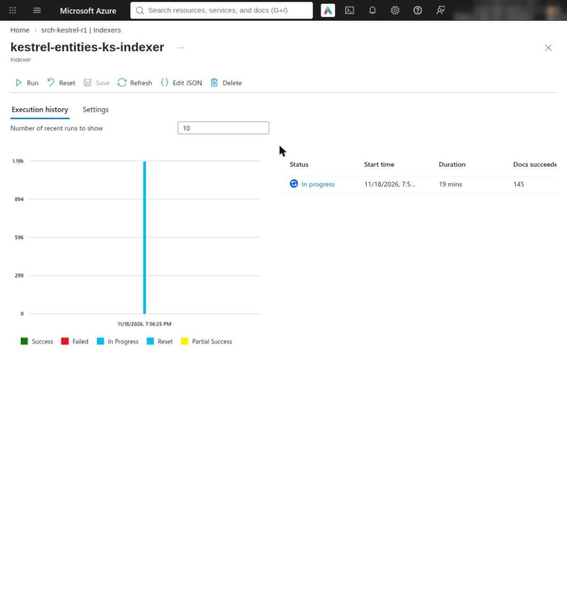

- **The list view:** *Docs succeeded 123/123* and *Errors/Warnings 0/400*. The 400 is a cap on how many warnings are reported, not a real total. The execution history shows a single long-running run, 19 minutes in at the time of the screenshot.
- **Schedule:** `P1D`, a daily run. On later runs only changed blobs are processed.
- **Batch size:** blob indexers default to 10 documents per batch ([large data sets](https://learn.microsoft.com/azure/search/search-how-to-large-index#check-indexer-batch-size)).
- **Run window:** indexers with a skillset run for at most 2 hours per run. If a run doesn't finish, the next scheduled run continues where it stopped. At 6.7 documents per minute that means about 800 documents per run. For a large corpus, plan for several runs, or raise `pageDegreeOfParallelism` when you create the source.
- **Failure handling:** `maxFailedItems: -1` means a failing document doesn't stop the run. Check `itemsFailed` yourself.

## 6. The indexes

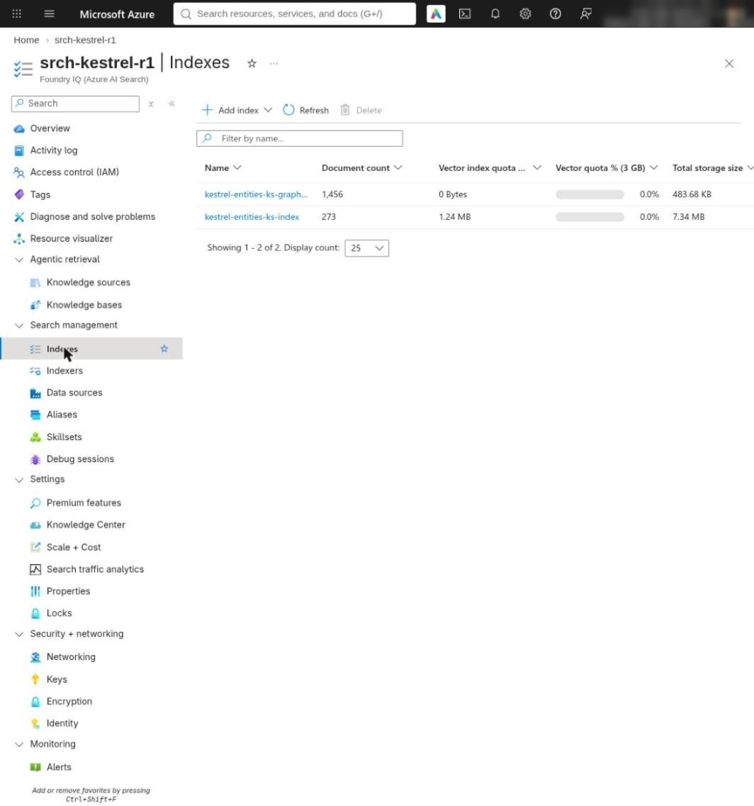

Two indexes, both owned by the knowledge source. The document counts measure different things, so they aren't comparable:

- **Chunk index (`kestrel-entities-ks-index`):** 273 documents at screenshot time, one per chunk. It holds 7.34 MB of storage and 1.24 MB of vector index.
- **Graph index (`kestrel-entities-ks-graph-index`):** 1,456 documents, one per triple, i.e. one edge in the graph. It uses 0 bytes of vector quota, because it has no vectors.

The portal's counts lag: the live API counts were higher at the same moment.

### 6a. The chunk index

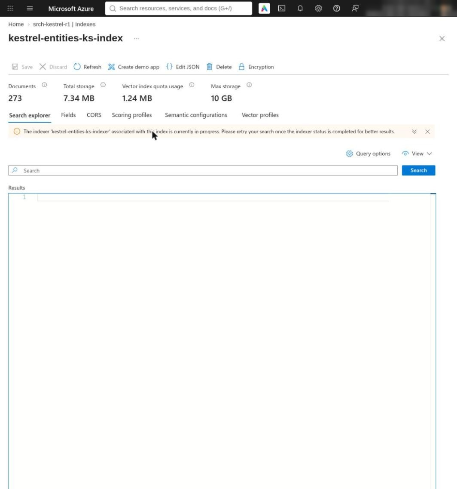
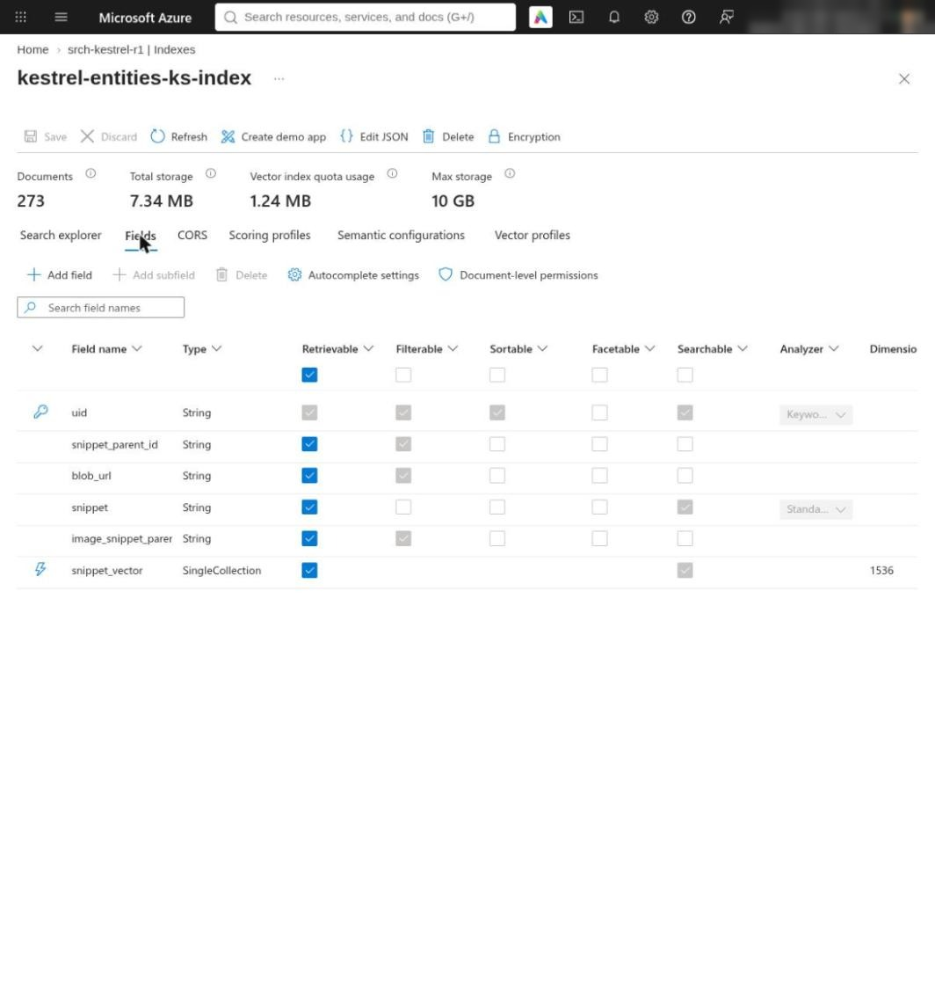

- **`uid`:** the key. It's a projected key value: a hash, the parent key and the annotation path (`..._pages_0`). The indexer uses it to keep chunks in sync when a source document changes ([projected key value](https://learn.microsoft.com/azure/search/search-how-to-define-index-projections#projected-key-value)).
- **`snippet_parent_id`:** the parent document. It's filterable, so you can fetch all chunks of one file.
- **`snippet`:** the chunk text. It's searchable with the standard analyzer for BM25.
- **`blob_url`:** the source file, used for citations.
- **`snippet_vector`:** 1,536 dimensions, searchable and retrievable. The topic graph build needs exactly this: a stored, retrievable vector field with a cosine or dotProduct HNSW profile.

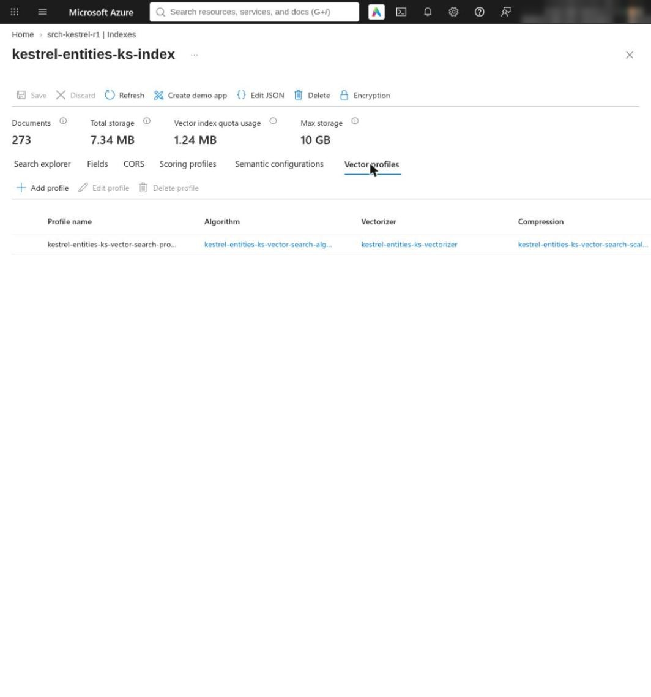

The vector profile ties three things together ([create a vector index](https://learn.microsoft.com/azure/search/vector-search-how-to-create-index#add-a-vector-search-configuration)):

- **Algorithm:** HNSW with `metric: cosine`, `m: 4`, `efConstruction: 400`, `efSearch: 500`. These are the documented defaults, and cosine is the right metric for Azure OpenAI embeddings.
- **Vectorizer:** the same `text-embedding-3-small` deployment, so queries can send text and the service embeds them. This is what lets a knowledge base and `vectorQueries: [{kind: "text"}]` work without client-side embedding.
- **Compression:** scalar quantization to `int8`, with rescoring (`preserveOriginals`, oversampling 4). Learn says int8 makes the vector index about four times smaller. The original full-precision vectors are kept to rescore the top candidates, which costs some extra storage ([quantization](https://learn.microsoft.com/azure/search/vector-search-how-to-quantization)). The generated index turns this on without being asked.

The index also has a **semantic configuration** over `snippet`, using `rankingOrder: BoostedRerankerScore`. That's what the semantic ranker and the knowledge base's reranking step use.

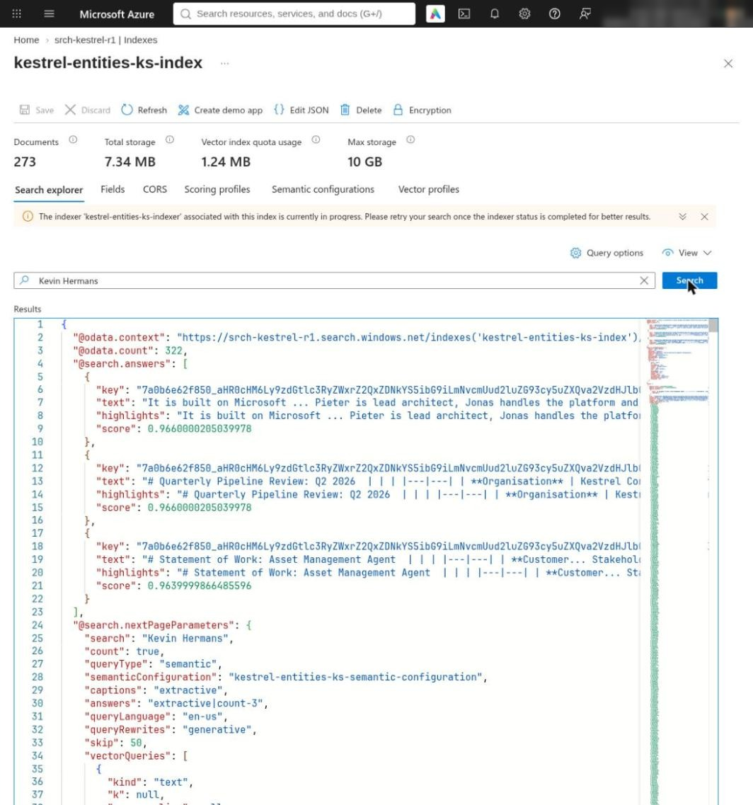

A search for "Kevin Hermans" in Search explorer. The request the portal sends by default is visible in `@search.nextPageParameters`:

- `queryType: semantic`
- extractive captions and answers
- `queryRewrites: generative`
- a text vector query

So Search explorer runs hybrid search with semantic reranking and query rewriting. The three `@search.answers` at the top are extractive answers that the semantic ranker lifted out of chunks. Our "plain RAG" baseline uses a very similar query, which makes it a strong baseline rather than a straw man.

### 6b. The graph index

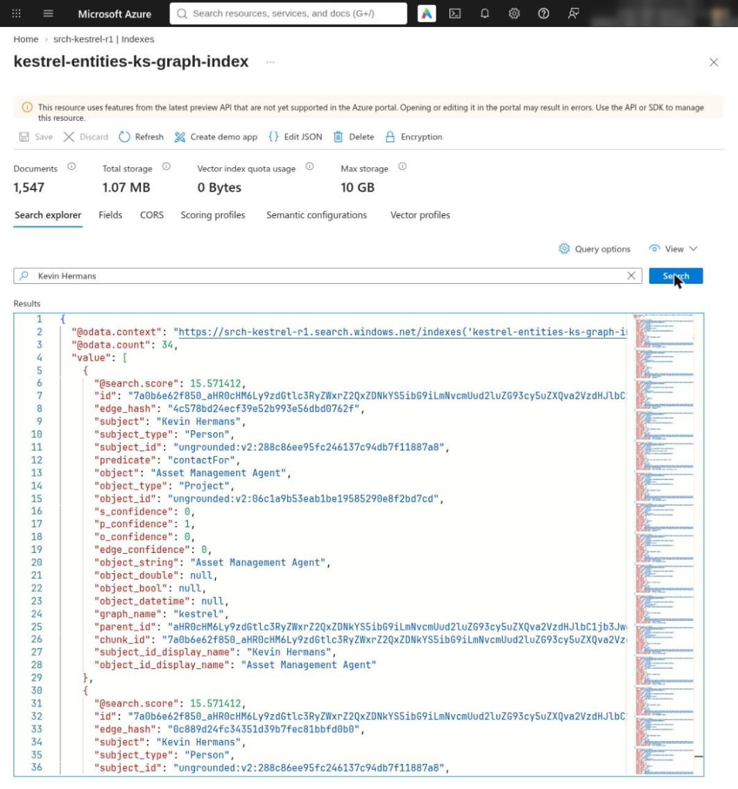

The same search on the graph index returns **triples**. Each search document is one edge:

```text
Kevin Hermans (Person) —contactFor→ Asset Management Agent (Project)
```

What the fields show:

- **`subject_id` / `object_id` are stable entity IDs.** That's how `search.graph` turns separate triple documents into a connected graph: two triples about the same `subject_id` share a node. Joining on IDs instead of display names is what makes multi-hop GQL work.
- **The IDs start with `ungrounded:v2:`.** Combined with `grounding: null` in the skillset, we read this as: entities weren't linked to an external reference, so their identity comes only from the extracted text. That would explain why the graph has duplicate nodes such as "Amira" next to "Amira El Idrissi", and "Fortalis" next to "Fortalis Verzekeringen". This is our interpretation. Learn doesn't document grounding yet.
- **Confidence scores are 0.** `edge_confidence`, `s_confidence` and `o_confidence` are 0 for every edge we checked; only `p_confidence` is 1. The session presented the triple index as having confidence scores, but with `minEdgeConfidence: null` and no grounding, they aren't filled in here.
- **`parent_id` and `chunk_id` are provenance.** Every triple points back to the chunk it came from. In a GQL query with `provenance: {kind: "hydrate"}`, these fields let the service return the source passages for each row ([query the graph directly with GQL](https://learn.microsoft.com/azure/search/agentic-knowledge-source-how-to-entity-graph#query-the-graph-directly-with-gql)).

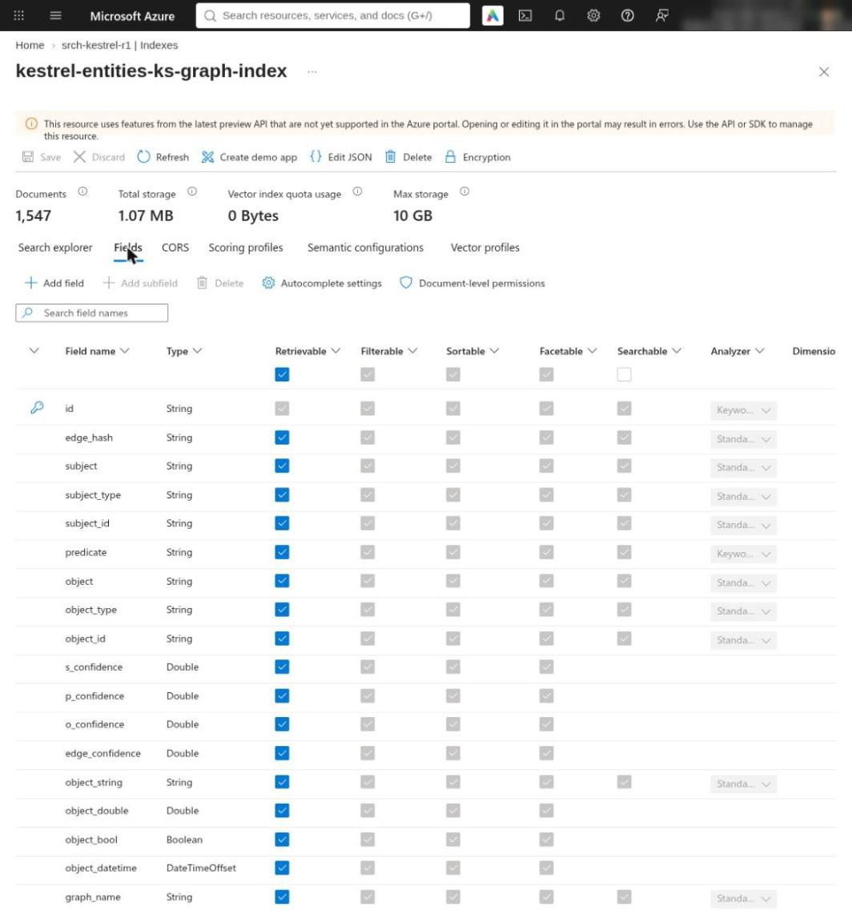

The schema is fixed by the service, not by your ontology. Every triple has the same fields whatever the ontology says. The ontology only decides which values end up in `subject_type`, `predicate` and `object_type`. Typed object fields (`object_double`, `object_bool`, `object_datetime`) exist for literal values. Our ontology has only relationships between entities, so they're always empty.

The portal doesn't show a part of the index definition that matters: a **`graphProfile`** of kind `edgeList`. It tells the engine which field is the subject, the predicate, the object, the confidence and the source chunk, and it names `kestrel-entities-ks-index` as the `provenanceIndexName` ([graph index JSON](definitions/index_kestrel-entities-ks-graph-index.json)). That profile is what makes this "just an index" queryable as a graph through `POST /indexes('...')/docs/search.graph` with a `gql` body.

## 7. The knowledge base

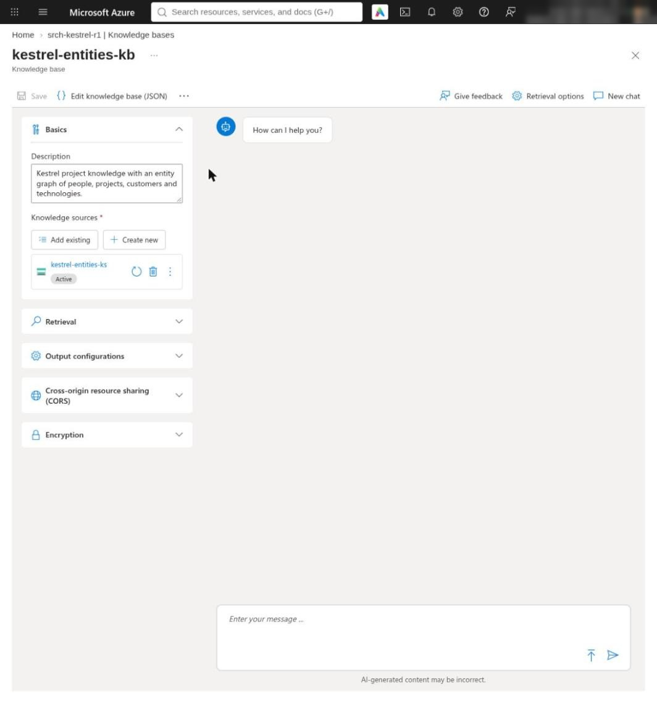
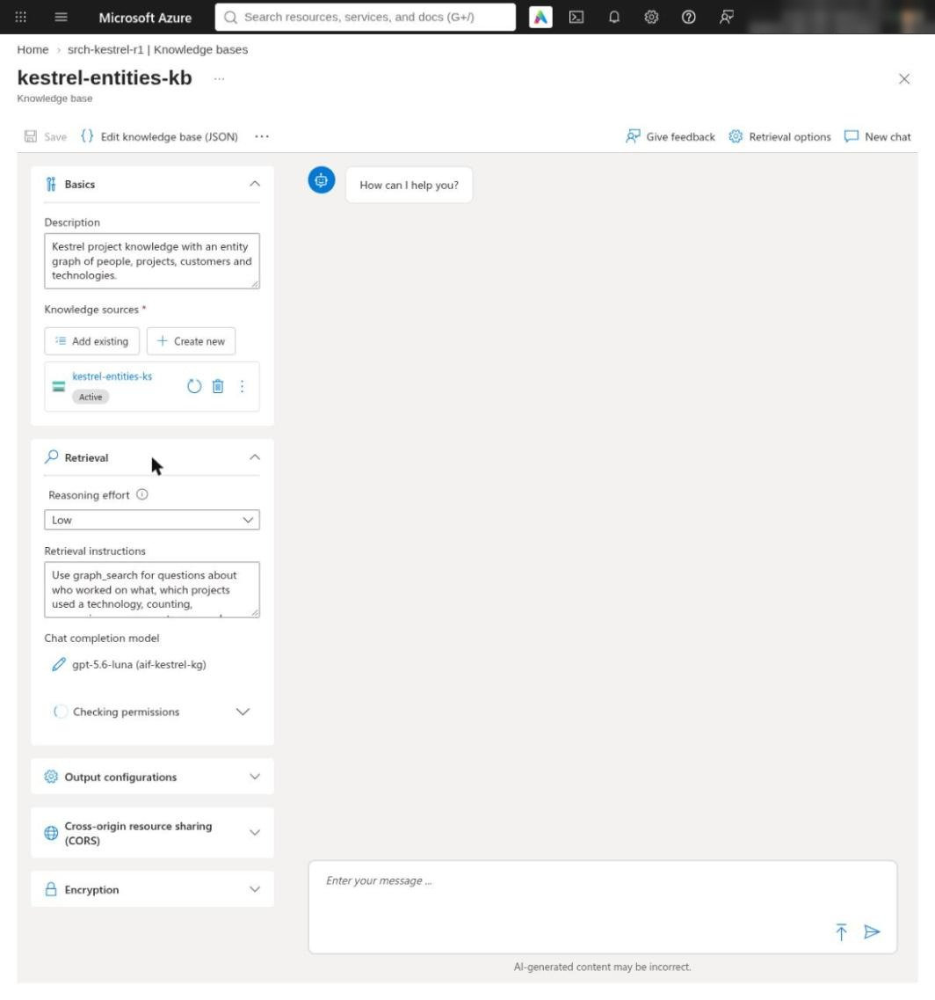

What the settings mean:

- **Knowledge sources:** `kestrel-entities-ks`, marked *Active*. A knowledge base can combine several sources. The planner chooses among them using their names, descriptions and the retrieval instructions ([knowledge source selection](https://learn.microsoft.com/azure/search/agentic-knowledge-source-overview#using-knowledge-sources)).
- **Reasoning effort: Low.** Microsoft documents four levels ([retrieval reasoning effort](https://learn.microsoft.com/azure/search/agentic-retrieval-how-to-set-retrieval-reasoning-effort)):

  | Level | What it does |
  |---|---|
  | `minimal` | No model planning |
  | `low` | One planning pass |
  | `medium` | Adds a semantic classifier that can trigger one retry with new queries. Available in select regions, including West US 3 |
  | `auto` (preview) | Starts light and escalates when needed |

  A request can override the knowledge base's setting.
- **Retrieval instructions:** free text that steers the planner. In our tests it changed which source the planner chose, but not how the GQL was written. Schema hints placed here had no effect on the generated queries.
- **Output mode (in the JSON): `extractiveData`.** The knowledge base returns retrieved content, and your own model writes the answer. The alternative, `answerSynthesis`, has the knowledge base write a cited answer itself. We use `extractiveData` so every retrieval strategy is answered by the same model.

### The playground and the debug log

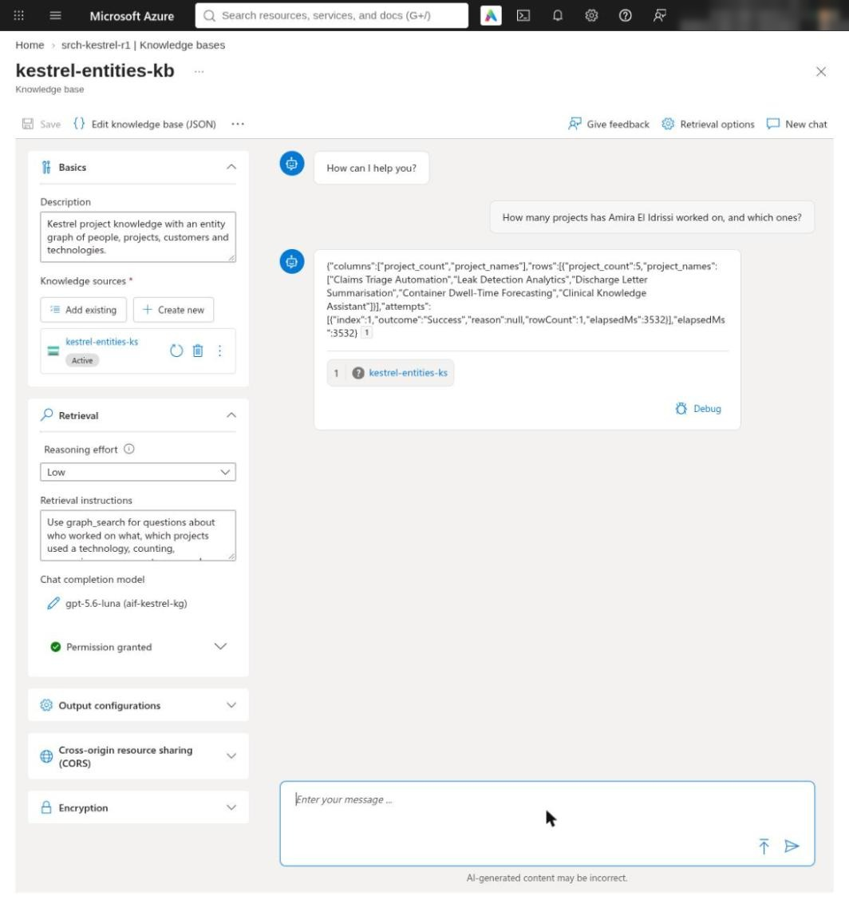

The question was "How many projects has Amira El Idrissi worked on, and which ones?". The answer isn't prose but a JSON object:

- `columns: ["project_count", "project_names"]`
- one row: 5 projects
- `attempts: [{outcome: "Success", rowCount: 1}]`

That's the raw result of a GQL query, shown as-is because the output mode is `extractiveData`. It said 5 because extraction was still running. The completed graph from our earlier run in Sweden Central returned all 7. The citation points to the knowledge source.

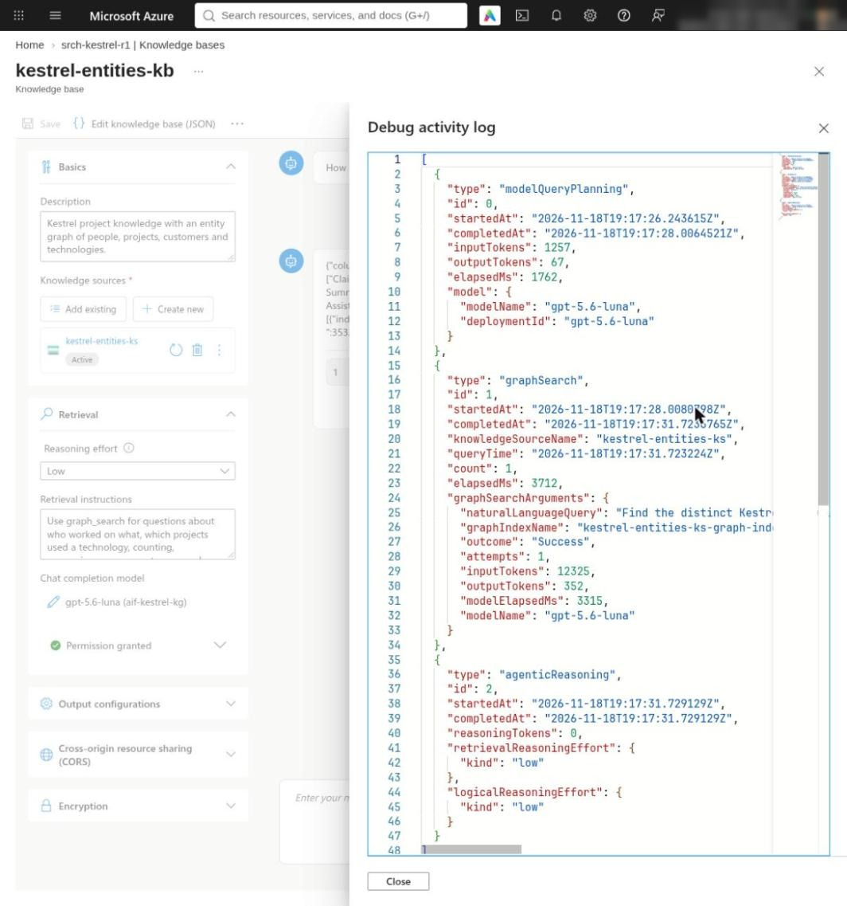

The debug log is the most useful screen for understanding agentic retrieval. It's the response's `activity` array ([activity array](https://learn.microsoft.com/azure/search/agentic-retrieval-how-to-retrieve#activity-array)). There are three steps:

1. **`modelQueryPlanning`** with `gpt-5.6-luna`: 1,257 input tokens, 67 output tokens, 1.8 s. The planner reads the question and decides to use graph search.
2. **`graphSearch`** with `count: 1`: 3.7 s, which includes 3.3 s of model time. The `graphSearchArguments` contain:
   - `naturalLanguageQuery`: the planner's **rewrite** of the question. It starts with "Find the distinct Kestr…", so the planner added "Kestrel" on its own.
   - the GQL the model generated (with `includeQuery: true`)
   - `outcome: Success` after 1 attempt
   - `inputTokens: 12,325` for generating the GQL
3. **`agenticReasoning`**: the effort actually applied, `low`.

**Why this matters.** The 12,325 tokens are a fixed cost per graph question. The model gets the ontology and instructions every time, however small the corpus. On our 246 short documents, that makes graph retrieval about 5× more expensive in tokens than plain RAG, which used about 2,500 tokens per question. On a large corpus, the comparison flips: Microsoft's SEC-filings evaluation reported 64% fewer tokens for entities than for RAG.

The log also shows where errors come from. With our first ontology, the planner's rewrite added a "Kestrel Consulting" filter that the graph couldn't satisfy. Every query was syntactically valid GQL, ran successfully, and returned 0 rows. A successful query that answers the wrong question looks exactly like a correct "no".

## 8. What the portal doesn't show (yet)

| Configuration | Where to find it instead |
|---|---|
| Ontology, `graphName`, extraction parallelism | Knowledge source JSON: `azureBlobParameters.graphExtraction` |
| Graph index as a created resource | Knowledge source JSON: `createdResources.graphIndex` |
| Triple extraction internals (alignment, grounding, token budgets) | Skillset JSON: `TripleExtractionSkill` |
| The graph profile that makes `search.graph` work | Graph index JSON: `graphProfile` |
| Output mode, answer instructions, KB tools | Knowledge base JSON |
| Running GQL directly | Not in the portal. Use `POST /indexes('<graph-index>')/docs/search.graph`, or the Foundry IQ skills plugin |

Microsoft says it plainly: the entity graph feature is **API-only** in this release, with a built-in UI only through the [Foundry IQ skills plugin](https://learn.microsoft.com/azure/search/agentic-retrieval-how-to-install-foundry-iq-skills).

## 9. Takeaways

1. **A graph is an index with a profile.** Foundry IQ stores the graph as ordinary search documents, one per triple, and a `graphProfile` lets GQL traverse them. You can inspect it with Search explorer, filter it, and count it like any index.
2. **Everything is generated, so the decisions come first.** The ontology, the ingestion cache, and the knowledge base are effectively fixed once created. Test on a small sample before ingesting everything.
3. **Extraction cost scales with chunks; query cost scales with the schema.** Chunk size and parallelism decide ingestion time and tokens. The ontology size drives the roughly 12,000-token GQL generation cost per graph question.
4. **Read the debug log.** It shows the planner's rewrite of your question, the generated GQL, and the token cost of each step. Every graph failure we saw was visible there.
5. **Entity resolution and confidence aren't solved for you.** Ungrounded IDs and zero confidence scores mean you should expect duplicate nodes, and design queries (or your own GQL agent) to cover name variants.

## Sources

- [What is Foundry IQ?](https://learn.microsoft.com/azure/foundry/agents/concepts/what-is-foundry-iq)
- [Create and query an entity graph (preview)](https://learn.microsoft.com/azure/search/agentic-knowledge-source-how-to-entity-graph)
- [Configure topic graph retrieval (preview)](https://learn.microsoft.com/azure/search/agentic-knowledge-source-how-to-topic-graph)
- [Create a blob knowledge source](https://learn.microsoft.com/azure/search/agentic-knowledge-source-how-to-blob)
- [Set the retrieval reasoning effort](https://learn.microsoft.com/azure/search/agentic-retrieval-how-to-set-retrieval-reasoning-effort)
- [Query a knowledge base (retrieve action and MCP)](https://learn.microsoft.com/azure/search/agentic-retrieval-how-to-retrieve)
- [Use Microsoft Retriever 1](https://learn.microsoft.com/azure/search/agentic-retrieval-how-to-use-microsoft-retriever)
- [Enable or disable agentic retrieval billing](https://learn.microsoft.com/azure/search/agentic-retrieval-how-to-enable-disable)
- [Supported regions and Fetch Offerings](https://learn.microsoft.com/azure/search/search-region-support)
- [Choose a pricing model and service tier](https://learn.microsoft.com/azure/search/search-sku-tier)
- [Text Split skill](https://learn.microsoft.com/azure/search/cognitive-search-skill-textsplit) and [chunking large documents](https://learn.microsoft.com/azure/search/vector-search-how-to-chunk-documents)
- [Index projections for parent-child indexing](https://learn.microsoft.com/azure/search/search-how-to-define-index-projections)
- [Create a vector index](https://learn.microsoft.com/azure/search/vector-search-how-to-create-index) and [scalar and binary quantization](https://learn.microsoft.com/azure/search/vector-search-how-to-quantization)
- [Change and delete detection for Azure Storage](https://learn.microsoft.com/azure/search/search-how-to-index-azure-blob-changed-deleted)
- [Create an indexer: change detection](https://learn.microsoft.com/azure/search/search-how-to-create-indexers#change-detection-and-internal-state) and [indexing large data sets](https://learn.microsoft.com/azure/search/search-how-to-large-index)
- [Install the Foundry IQ skills plugin](https://learn.microsoft.com/azure/search/agentic-retrieval-how-to-install-foundry-iq-skills)
